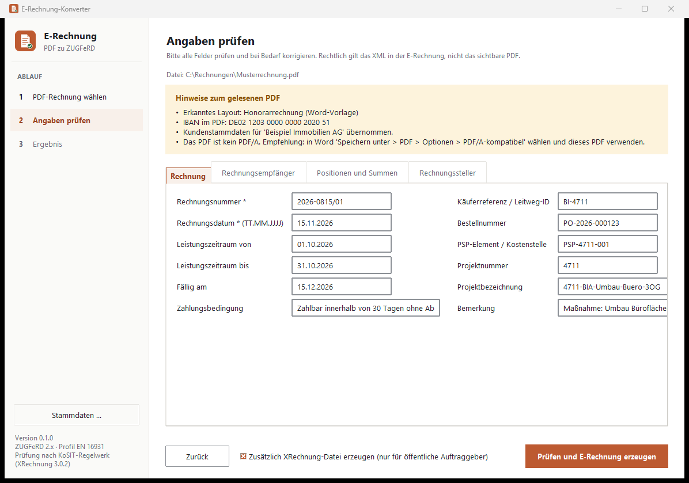
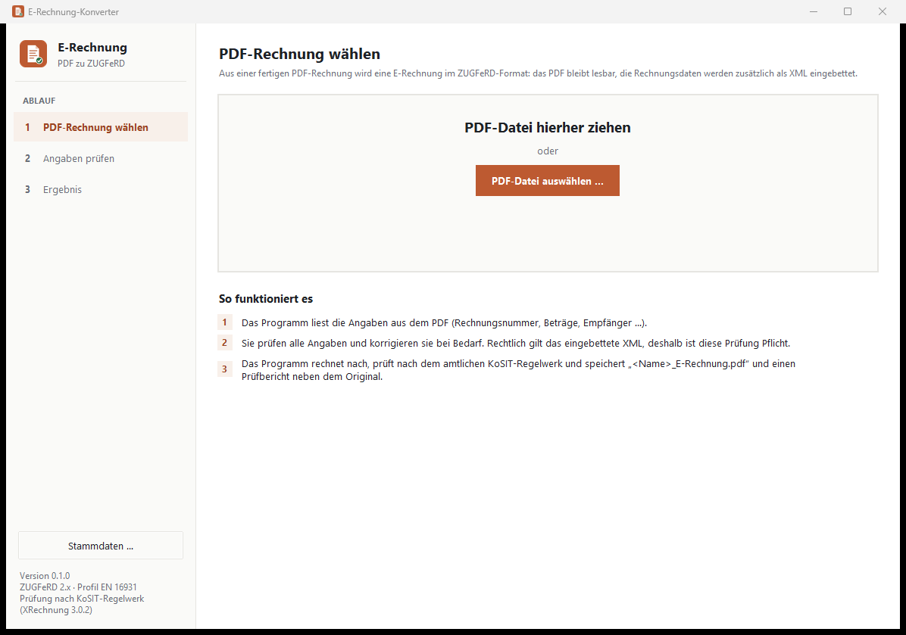
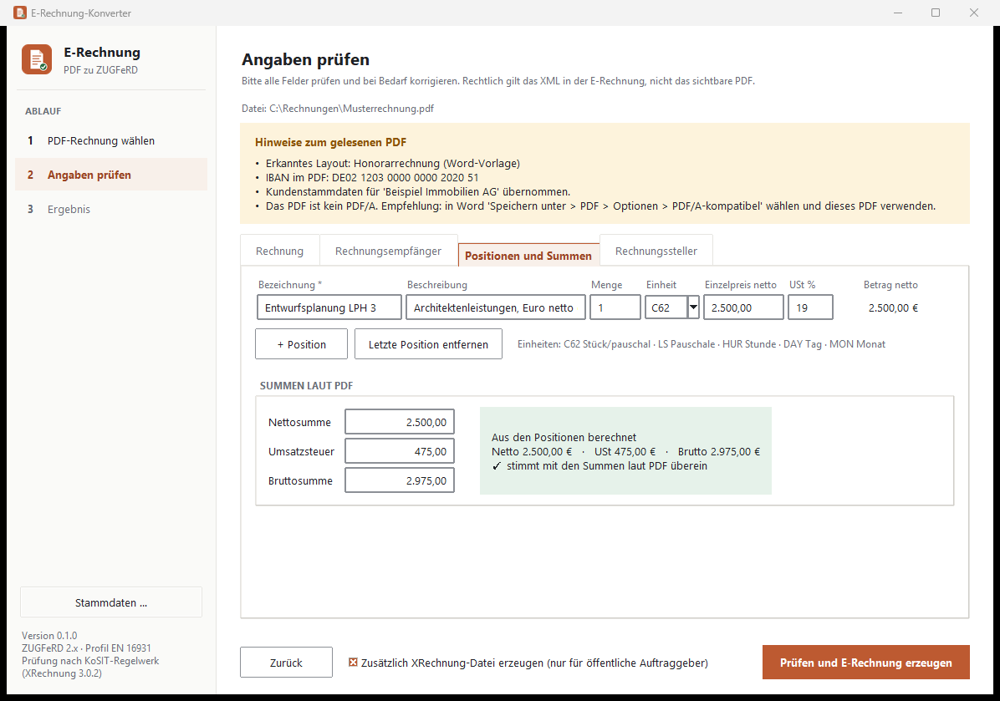
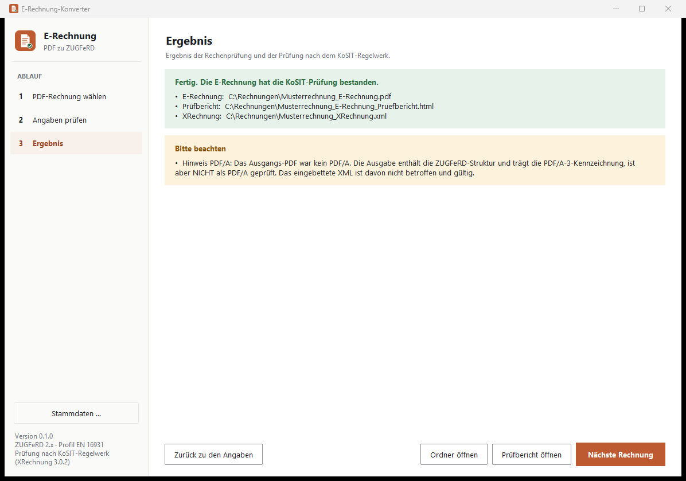

<div align="center">


# E-Rechnung-Konverter: PDF-Rechnung in ZUGFeRD-E-Rechnung umwandeln

**Kostenlos, quelloffen, ohne Installation.** Aus jeder PDF-Rechnung (zum Beispiel aus Word) wird eine
gültige **E-Rechnung nach ZUGFeRD 2.x / Factur-X (EN 16931)**, auf Wunsch zusätzlich eine
**XRechnung**. Jede Rechnung wird vor dem Speichern nach dem amtlichen **KoSIT-Regelwerk** geprüft,
ganz ohne Java und ohne Cloud.

[](LICENSE)
[](#herunterladen)
[](#was-ist-zugferd)
[](#xrechnung)
[](#prüfung-nach-dem-kosit-regelwerk-ohne-java)
[](https://github.com/caglarbiber90/e-rechnung-zugferd-konverter/actions/workflows/tests.yml)

[Herunterladen](#herunterladen) · [So geht's](#so-gehts-in-drei-schritten) · [Häufige Fragen](#häufige-fragen) · [Kommandozeile und KI-Agenten](#kommandozeile-automatisierung-und-ki-agenten) · [Selbst bauen](#selbst-bauen)



</div>

## Warum dieses Programm?

Seit dem **1. Januar 2025** müssen alle Unternehmen in Deutschland E-Rechnungen **empfangen** können.
Ab dem **1. Januar 2027** müssen Unternehmen mit mehr als 800.000 Euro Vorjahresumsatz im Geschäft mit
anderen Unternehmen (B2B) E-Rechnungen **ausstellen**, ab dem **1. Januar 2028** alle Unternehmen
(Wachstumschancengesetz, § 14 UStG). Ein normales PDF zählt dann nicht mehr als E-Rechnung.

Viele kleine Büros, Handwerksbetriebe, Planungsbüros, Freiberufler und Vereine schreiben ihre
Rechnungen aber in **Word** oder einer eigenen Vorlage. Dieses Programm schließt die Lücke:

- Rechnung wie gewohnt schreiben und als PDF speichern,
- PDF in den E-Rechnung-Konverter ziehen,
- Angaben prüfen, fertig: `Rechnung_E-Rechnung.pdf` liegt neben dem Original.

Das PDF bleibt für Menschen lesbar, die Rechnungsdaten stecken zusätzlich als XML (`factur-x.xml`)
darin. So kann die Buchhaltung des Kunden die Rechnung automatisch verarbeiten.

## Funktionen

- **Eine einzige `.exe`**: doppelklicken, Rechnung umwandeln, schließen. Keine Installation, keine
  Administratorrechte, kein Python, kein Java.
- **Alles bleibt auf dem eigenen Rechner.** Keine Cloud, kein Konto, keine Übertragung von Daten.
- **Liest die Rechnung aus dem PDF**: Rechnungsnummer, Datum, Leistungszeitraum, Empfänger, Bestellnummer,
  Kostenstelle/PSP-Element, Projekt, Positionen, Netto, Umsatzsteuer, Brutto, Zahlungsbedingung.
- **Pflicht-Prüfformular**: Jede Angabe kann vor dem Erzeugen korrigiert werden. Rechtlich gilt das XML,
  deshalb wird dieser Schritt nie übersprungen.
- **Rechenprüfung**: Positionen ergeben die Nettosumme, Netto plus Umsatzsteuer ergibt die Bruttosumme.
- **Amtliche Prüfung nach dem KoSIT-Regelwerk** (XRechnung 3.0.2 mit EN-16931-Regeln) vor dem Speichern.
  Fehler werden in verständlichem Deutsch erklärt.
- **Prüfbericht** als HTML neben jeder E-Rechnung.
- **Stammdaten** des eigenen Betriebs und der Kunden werden einmal eingegeben und gespeichert.
- **XRechnung** (CII) optional für öffentliche Auftraggeber.
- **Kommandozeile mit JSON-Ausgabe** für Automatisierung, Skripte und KI-Agenten.
- **Quelloffen** unter MIT-Lizenz.

## Herunterladen

Die fertige Datei `E-Rechnung-Konverter.exe` gibt es unter
[**Releases**](https://github.com/caglarbiber90/e-rechnung-zugferd-konverter/releases/latest).
Herunterladen, doppelklicken, fertig. Beim ersten Start fragt das Programm einmalig die Daten des
eigenen Betriebs ab.

> Windows SmartScreen kann bei neuen, nicht signierten Programmen warnen. Über „Weitere Informationen“
> und „Trotzdem ausführen“ lässt sich das Programm starten. Wer sichergehen will, baut die Datei
> [selbst aus dem Quelltext](#selbst-bauen).

## So geht's in drei Schritten

| 1. PDF wählen | 2. Angaben prüfen | 3. Fertig |
|---|---|---|
|  |  |  |
| Datei auswählen oder ins Fenster ziehen | alle Felder kontrollieren, Summen werden nachgerechnet | E-Rechnung und Prüfbericht liegen neben dem Original |

Ergebnis im Ordner der Originalrechnung:

- `<Name>_E-Rechnung.pdf`: die ZUGFeRD-E-Rechnung zum Versenden
- `<Name>_E-Rechnung_Pruefbericht.html`: das Prüfprotokoll
- optional `<Name>_XRechnung.xml`: für öffentliche Auftraggeber

## Häufige Fragen

### Wie erstelle ich aus einer Word-Rechnung eine E-Rechnung?
Rechnung in Word als PDF speichern (am besten mit *Optionen > „PDF/A-kompatibel“*), das PDF mit dem
E-Rechnung-Konverter öffnen, Angaben prüfen und auf „Prüfen und E-Rechnung erzeugen“ klicken.

### Was ist ZUGFeRD?
ZUGFeRD ist ein deutsches Format für E-Rechnungen: ein PDF, in das die Rechnungsdaten als XML
eingebettet sind. Die Version 2.x ist technisch gleich mit dem französischen Factur-X. Das Profil
**EN 16931** (früher „Comfort“) erfüllt die gesetzlichen Anforderungen an eine E-Rechnung. Die Profile
MINIMUM und BASIC WL reichen dafür nicht.

### XRechnung
XRechnung ist das reine XML-Format für Rechnungen an Behörden und öffentliche Auftraggeber. Der
Konverter kann zusätzlich eine XRechnung (Syntax CII) schreiben. Dafür ist die **Käuferreferenz**
(Leitweg-ID) Pflicht.

### Ist ZUGFeRD für Rechnungen zwischen Unternehmen erlaubt?
Ja. ZUGFeRD ab Version 2.0.1 im Profil EN 16931 (oder höher) erfüllt die Anforderungen der europäischen
Norm EN 16931 und ist für B2B-Rechnungen in Deutschland zulässig.

### Brauche ich Java, Python oder eine Internetverbindung?
Nein. Alles Nötige steckt in der `.exe`. Die Prüfung läuft vollständig auf dem eigenen Rechner.

### Wie sicher ist die Prüfung?
Der Konverter verwendet unverändert die offiziellen Prüfdateien der KoSIT (Koordinierungsstelle für
IT-Standards). Ergebnisse und Regelcodes stimmen mit dem offiziellen Java-Validator überein, siehe
[Prüfung ohne Java](#prüfung-nach-dem-kosit-regelwerk-ohne-java).

### Ist die erzeugte Datei PDF/A-3?
Die Datei bekommt die ZUGFeRD-Struktur und die Kennzeichnung PDF/A-3B. Ob das Ausgangs-PDF wirklich
PDF/A-konform ist, prüft das Programm **nicht** und sagt das auch deutlich. Word erzeugt ein PDF/A,
wenn beim Speichern *„PDF/A-kompatibel“* angehakt ist. Das eingebettete XML ist davon unabhängig gültig.

### Funktioniert das mit jeder Rechnungsvorlage?
Die Version 0.1 erkennt eine verbreitete Word-Vorlage (Zeilen wie `Bestellnummer:`, `PSP:`,
`Leistungsempfänger:`, `Rechnungssumme`). Bei anderen Layouts füllt man das Formular von Hand aus
oder ergänzt eine Vorlage in `src/erechnung/extract.py`. Beispiele für neue Layouts sind als
[Fehlermeldung oder Wunsch](https://github.com/caglarbiber90/e-rechnung-zugferd-konverter/issues)
willkommen (bitte nur mit erfundenen Daten).

### Was wird noch nicht unterstützt?
Steuerfreie Leistungen (0 %), Reverse Charge, Rabatte und Zuschläge auf Belegebene, Gutschriften und
eingescannte PDFs ohne Text.

### Ersetzt das eine Steuerberatung?
Nein. Bitte jede Rechnung vor dem Versand prüfen.

## Kommandozeile, Automatisierung und KI-Agenten

Dieselbe `.exe` (oder das Python-Paket) lässt sich ohne Fenster steuern. Alle Ausgaben sind JSON
in UTF-8, alle Feldnamen sind Deutsch.

```powershell
# 1. Vorschlag aus dem PDF lesen
E-Rechnung-Konverter.exe auslesen Rechnung.pdf --stammdaten stammdaten.json > daten.json

# 2. daten.json prüfen und korrigieren (Pflicht: rechtlich gilt das XML)

# 3. E-Rechnung erzeugen (nur wenn Rechenprüfung und KoSIT-Prüfung bestanden sind)
E-Rechnung-Konverter.exe erstellen Rechnung.pdf --daten daten.json --xrechnung

# Vorhandene E-Rechnung oder XML prüfen
E-Rechnung-Konverter.exe pruefen Rechnung_E-Rechnung.pdf
```

Rückgabewerte: `0` erfolgreich, `1` Prüfung nicht bestanden, `2` Aufruffehler.
Als Python-Paket:

```powershell
py -3 -m pip install "git+https://github.com/caglarbiber90/e-rechnung-zugferd-konverter"
e-rechnung --help
```

Hinweise für KI-Agenten und Entwickler stehen in [`AGENTS.md`](AGENTS.md) und [`llms.txt`](llms.txt).

## Prüfung nach dem KoSIT-Regelwerk ohne Java

Der offizielle KoSIT-Validator ist ein Java-Programm. Damit die `.exe` ohne Java auskommt, führt der
Konverter **dieselben Prüfdateien** direkt aus:

1. XML-Schema (UN/CEFACT CII D16B) mit `lxml`,
2. die vorkompilierten Schematron-Regeln der KoSIT-Konfiguration (EN 16931 CII, XRechnung CII) mit
   Saxon-HE (`saxonche`),
3. die Bewertungsregel des KoSIT-Berichts (Anpassungen der Fehlerstufen aus `scenarios.xml`;
   nicht bestanden, sobald eine Meldung der Stufe „Fehler“ vorliegt).

Gegenprobe mit dem Java-Validator 1.6.3 und derselben Konfiguration (`tools/compare_java.py`):

| Testfall | Ergebnis (beide gleich) | Regelcodes |
|---|---|---|
| gültige Rechnung (EN 16931 und XRechnung) | bestanden | keine |
| falsche Bruttosumme | nicht bestanden | BR-CO-15, BR-CO-16 |
| leere IBAN | nicht bestanden | BR-50 (bei XRechnung zusätzlich PEPPOL-EN16931-R008, BR-DE-19) |
| fehlende Käuferreferenz (XRechnung) | nicht bestanden | BR-DE-15 |
| falscher XML-Aufbau | nicht bestanden | Schemafehler |

In allen 11 Testdateien stimmen Ergebnis und Regelcodes überein.

## Selbst bauen

Voraussetzungen: Windows, Python 3.12 oder neuer.

```powershell
py -3 -m pip install --user -e ".[dev]"
py -3 -m pytest -q
py -3 -m PyInstaller --noconfirm erechnung.spec
```

Ergebnis: `dist\E-Rechnung-Konverter.exe` (etwa 70 MB, der größte Teil ist Saxon-HE).

Weitere Werkzeuge in `tools/`:

| Befehl | Zweck |
|---|---|
| `py -3 tools/make_sample.py` | fiktive Musterrechnung und Musterstammdaten erzeugen |
| `py -3 tools/write_variants.py <ordner>` | gültige und absichtlich fehlerhafte XML-Testdateien schreiben |
| `py -3 tools/compare_java.py <validator.jar> <dateien>` | Gegenprobe mit dem Java-KoSIT-Validator |
| `py -3 tools/gui_shots.py <ordner>` | Oberfläche durchklicken und Bildschirmfotos speichern |
| `py -3 tools/make_icon.py` | Programmsymbol zeichnen |

## Projektaufbau

| Datei | Aufgabe |
|---|---|
| `src/erechnung/extract.py` | Felder aus dem PDF-Text lesen (erweiterbar über `EXTRACTORS`) |
| `src/erechnung/cii.py` | CII-XML erzeugen (EN 16931, optional XRechnung 3.0) |
| `src/erechnung/checks.py` | Rechenprüfung vor dem Erzeugen |
| `src/erechnung/validator.py` | KoSIT-Prüfung ohne Java |
| `src/erechnung/pdf.py` | PDF/A-Erkennung, Einbetten mit `factur-x` |
| `src/erechnung/gui.py` | Programmfenster (tkinter) |
| `src/erechnung/cli.py` | Kommandozeile (`auslesen`, `erstellen`, `pruefen`) |
| `src/erechnung/daten/kosit/` | KoSIT-Prüfkonfiguration XRechnung 3.0.2 (2026-09-02), unverändert |

## Mitmachen

Fehlermeldungen, neue Rechnungsvorlagen und Verbesserungen sind willkommen, siehe
[CONTRIBUTING.md](CONTRIBUTING.md). Bitte niemals echte Rechnungen oder Kundendaten hochladen.

Wenn das Programm Ihnen Arbeit spart: Ein ⭐ auf GitHub hilft anderen Betrieben, es zu finden.

## Lizenz

Der eigene Code steht unter der [MIT-Lizenz](LICENSE). Die mitgelieferten Fremdbestandteile
(KoSIT-Konfiguration, EN-16931-Schematron, Saxon-HE, factur-x, pypdf, lxml u. a.) haben eigene
Lizenzen, siehe [THIRD_PARTY_LICENSES.md](THIRD_PARTY_LICENSES.md).

Alle Namen, Adressen, Steuernummern und Bankdaten in `tests/sample/` und auf den Bildschirmfotos sind
erfunden.

<sub>Stichworte: E-Rechnung erstellen, E-Rechnung kostenlos, PDF in E-Rechnung umwandeln,
Word-Rechnung als E-Rechnung, ZUGFeRD erstellen, ZUGFeRD-Konverter, XRechnung erstellen,
Factur-X, EN 16931, E-Rechnungspflicht 2025 2027 2028, KoSIT-Validator ohne Java, CII,
Wachstumschancengesetz, Open Source, Windows.</sub>
